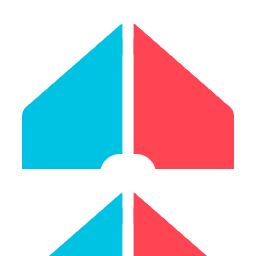
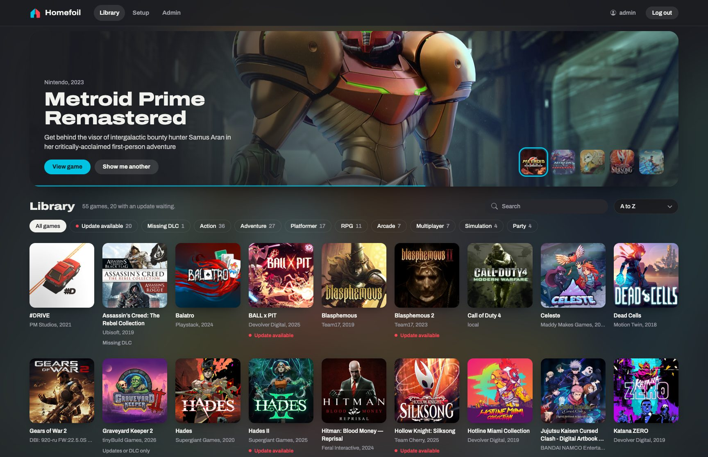
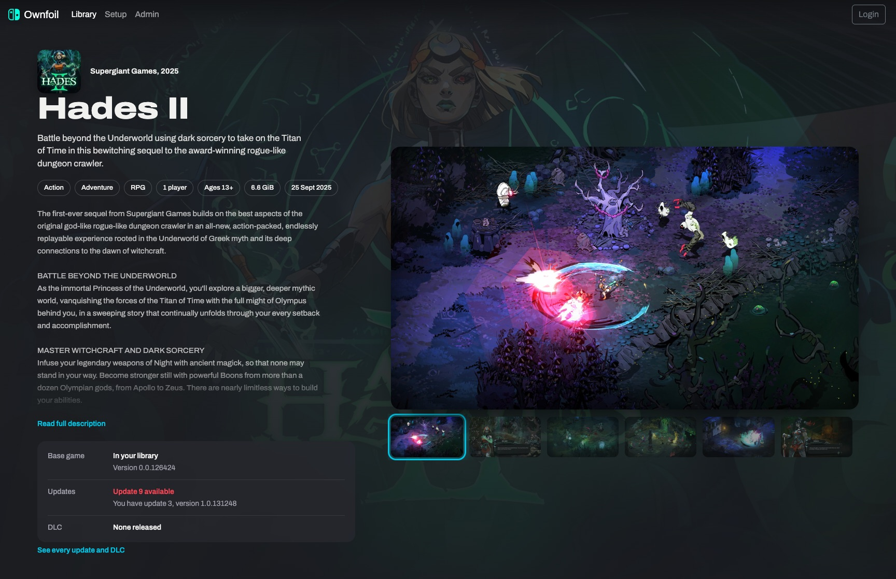
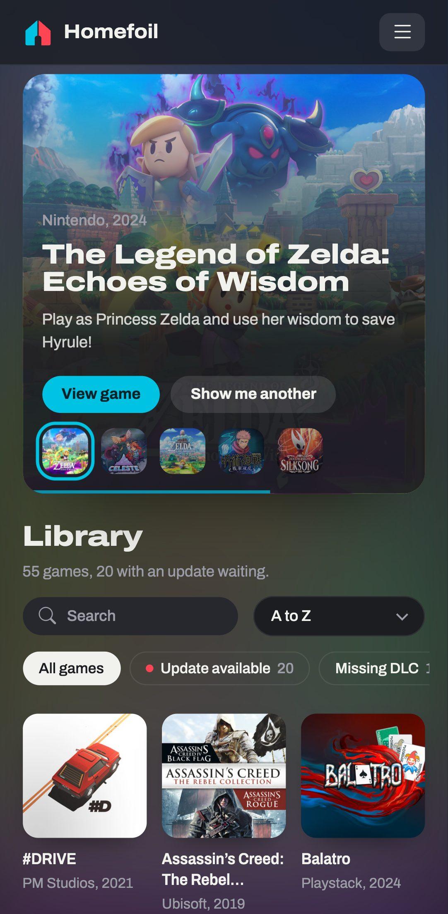
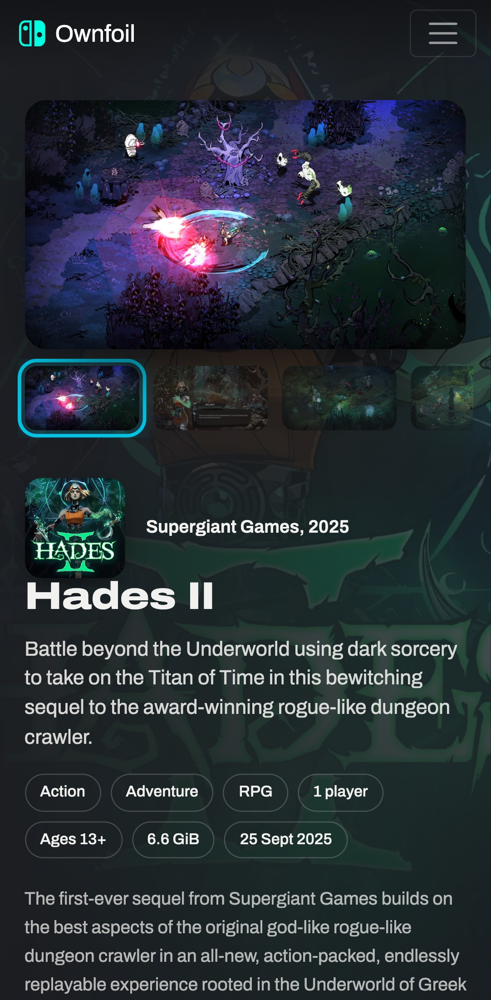

<p align="center">
  
</p>

<h1 align="center">Ownfoil</h1>

<p align="center">
  <b>Your Switch library, as a store you run at home.</b>
</p>

<p align="center">
  <b><a href="#install">Install</a></b> ·
  <a href="#add-it-to-your-switch">Add to Switch</a> ·
  <a href="https://github.com/a1ex4/ownfoil">Upstream</a> ·
  <a href="https://github.com/cobanov/ownfoil/issues">Issues</a>
</p>

> A fork of [a1ex4/ownfoil](https://github.com/a1ex4/ownfoil), going its own way.
> Same shop, settings and database. New web interface and many fixes.

<p align="center">
  <a href="docs/screenshots/library.jpg"></a>
  <a href="docs/screenshots/title.jpg"></a>
</p>
<p align="center">
  <a href="docs/screenshots/library-phone.jpg"></a>
  <a href="docs/screenshots/title-phone.jpg"></a>
</p>

## What's new

- Store-style library. Hover a game, it fills the top of the page.
- Search, genre filters, **Update available**, **Missing DLC** and sorting.
- One-screen game page: artwork, facts, screenshots, what you own.
- Works on phones.
- No requests to outside services. Even the font is served locally.
- Everything else is Ownfoil: shop for Tinfoil, Sphaira and CyberFoil, file identification,
  organizing, verifying, compressing, several users.

## What this fork fixes

**Data**
- An unmounted disk no longer wipes the library.
- Empty-folder cleanup never deletes the library folder.
- Old updates stay until the new one is verified.
- One unreadable folder no longer stops the scan.
- A file copied in during a scan no longer stops it.
- A crashed worker is restarted.
- No more broken artwork from two workers writing at once.

**Security**
- Deleted users stay logged out.
- The last admin can't be deleted.
- File names can't run code on the Tasks page.
- Login only redirects inside Ownfoil.
- Login doesn't reveal user names. Wrong passwords wait a second.
- SameSite cookies, checked key uploads, same-site live updates.
- Secure random key for Tinfoil.

**Display**
- Homebrew and ports, like Call of Duty 4, show in the library.
- No stale data after a settings or artwork change.
- An older owned DLC counts as owned.
- Release dates are right in every time zone.
- **Read full description** shows whenever text is cut.
- Every genre filter is reachable with a mouse.

Moving to this fork logs everyone out once.

## Install

You need Docker.

1. Get the code.
   ```sh
   git clone https://github.com/cobanov/ownfoil
   cd ownfoil
   ```
2. Edit `docker-compose.yml`:
   - Replace `/your/game/directory` with your games folder.
   - Uncomment `USER_ADMIN_NAME` and `USER_ADMIN_PASSWORD`, set your own.
3. Add your console keys.
   ```sh
   mkdir -p config && cp /path/to/prod.keys config/keys.txt
   ```
4. Start it.
   ```sh
   docker compose up -d --build
   ```
5. Open `http://<server-ip>:8465`. Your games show up after the first scan.

No keys yet? Upload them later in **Settings → Titles**.

Update with `git pull && docker compose up -d --build`.

## Add it to your Switch

Ownfoil's **Setup** page shows the exact values for your server.

**Sphaira** (recommended)
1. **Menu → Menus → Ownfoil**.
2. **Discover local servers**, pick your shop.

**Tinfoil**
1. **File Browser**, press **New**.
2. Fill in and save:

   | Field | Value |
   |---|---|
   | Protocol | `http` |
   | Host | your server's IP |
   | Port | `8465` |
   | Path | `/` |
   | Username, Password | your Ownfoil user |
   | Title | anything |

**CyberFoil**
1. **Settings → Shop → Add new shop**.
2. Protocol `HTTP`, your server's IP, port `8465`, your Ownfoil user.

More in [Usage.md](Usage.md).

## Want to tinker?

Flask, GraphQL and SQLite. Plain HTML, CSS and JS in the browser.

```sh
uv run --no-project --python 3.14 --with-requirements requirements.txt --with pytest pytest tests -q
```

Pull upstream changes with `git fetch upstream && git merge upstream/develop`.

## Thanks

- [a1ex4](https://github.com/a1ex4) and the Ownfoil contributors.
- [blawar](https://github.com/blawar) for Tinfoil, nsz and TitleDB.
- [nicoboss](https://github.com/nicoboss) for [nsz](https://github.com/nicoboss/nsz),
  [seiya-dev](https://github.com/seiya-dev) for [NSTools](https://github.com/seiya-dev/NSTools).
- [Archivo](https://github.com/Omnibus-Type/Archivo) (OFL) for the type.

---

AGPL-3.0, see [LICENSE.md](LICENSE.md). No keys, firmware or games in this repository.
Not affiliated with Nintendo.
